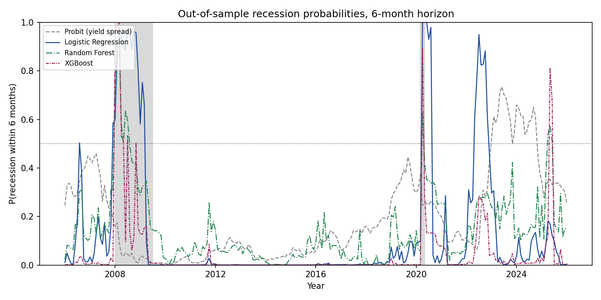

# prediction of US recessions with ml

ml project meant to beat the yield curve at forecasting recessions, six months in advance.

Twelve monthly FRED indicators from 1985-2026.
Five models: the Estrella-Mishkin yield-curve probit, the Sahm Rule, logistic regression, a random forest, and XGBoost.
Trained once on 1985 to mid-2005, tested on 2006 onward, so the 2008 crisis and COVID are genuinely out of sample.

## Results

| Model | ROC-AUC | Precision | Recall |
|---|---|---|---|
| Probit (yield spread) | 0.457 | 0.000 | 0.000 |
| Sahm Rule | 0.774 | n/a | n/a |
| **Logistic Regression** | **0.885** | 0.552 | 0.533 |
| Random Forest | 0.825 | 0.636 | 0.233 |
| XGBoost | 0.780 | 0.700 | 0.233 |

*241 test months, 30 of them recession-preceding. The Sahm Rule outputs a gap in percentage points rather than a probability, so the threshold columns don't apply to it. The probit is unweighted, as Estrella and Mishkin specify it, while the three ML models are class-balanced, so the ROC-AUC column compares like with like and the threshold columns do not.*



## What came out of it

Logistic regression won and both tree models lost to it. The ladder runs one variable, then twelve,
then non-linear, so a linear model coming out on top means the gain came from *more indicators*,
not from finding complex patterns. Four recessions in the whole sample with only two in the training
half is not enough for a tree to learn interactions from.

The complex models are cautious. XGBoost has the best precision at 0.700 and the worst recall at
0.233, so when it does call a recession it is usually right, and it almost never calls one. For an
early-warning tool that is the wrong way round.

None of the five predicted 2008. The probit peaked at 0.46 in April 2007 and was down to 0.19 by
December, the month the recession actually started. Logistic regression crossed 0.50 that same
December. XGBoost went from 0.015 in December 2007 to 0.976 in January 2008, a month after the
thing had already begun.

The probit's 0.457 is not the yield curve going quiet. It has one sustained run above 0.50 in twenty
test years, 21 months from January 2023 to October 2024 peaking at 0.734, and every one of them was
wrong. That run is the 2022-23 inversion no recession followed. It is visible in the chart above,
the grey dashed line sitting over the cutoff on the right.

The 0.885 deserves some suspicion too. A moving-block bootstrap over the test months puts it at 0.746
to 0.969, and the probit at 0.203 to 0.833, so the two intervals overlap. Four recessions is not
enough data to separate them cleanly, whatever the point estimates say. ROC-AUC also only says the
model ranks recession-preceding months above ordinary ones; precision of 0.552 is what happens when
it has to make the call. It raised 29
alarms and got 16 right. Its worst wrong one ran May to November 2022, and that was not the curve
either. The spread was still positive at 1.99 points when the model crossed 0.5 and did not go
negative until November. What moved was the six-month equity return, -1.6% in March 2022 to -20.4%
in April, against 8% inflation.

## Quick start

```bash
pip install -r requirements.txt
python -m src.download    # 12 FRED series, no API key needed
python -m src.features    # builds the monthly dataset
python -m src.evaluate    # fits and scores the five models
python -m src.tables      # regenerates Tables 1 to 3
python -m src.plots       # regenerates the figures
python -m pytest tests/   # leakage and publication-lag checks
```

Deterministic: same data in, same numbers out. About 12 minutes end to end on a laptop.

## Repo

```
src/config.py      series list, features, split date
src/download.py    keyless FRED CSV ingestion
src/features.py    transformations, 1-month publication lag, target
src/models.py      the five models
src/evaluate.py    train/test split + metrics (seed 42)
src/tables.py      the three numeric tables in the report
src/plots.py       the five report figures
tests/             leakage and lag guards
data/              raw FRED series + processed panel
results/           figures, tables, predictions
```

## Design notes

- One-month publication lag. Economic data arrives late, so every feature is lagged a month.
  Without it the model forecasts June using numbers that were not published until July, and the
  backtest becomes fiction.
- Split at 2006, not 2010. Puts two recessions on each side. A 2010 split leaves only COVID to test
  against, since 2008 would already be in training.
- Training stops in July 2005, not December. At a six-month horizon a row's label depends on the
  six months after it, so a row dated December 2005 is labelled using early-2006 data, which is
  inside the test period. Ending training six months before the split keeps the test set unseen.
- Accuracy is not used. Always saying "no recession" scores about 88% of the test months.
- Variable importance is read off the training fit, not the full sample. Ranking features on data
  the model never saw would be describing the answer rather than the forecast.

## Limitations

Only four recessions exist in the sample and two of them are in training, which is the binding
constraint on everything here. FRED serves revised data rather than real-time vintages, and ALFRED
would fix that. Several indicators overlap, and collinearity is the likely reason a couple of
logistic coefficients came out with signs that contradict theory, though refitting without the
duplicated pairs has not been done, so that stays a guess. COVID sits in the test window and
distorts it: one month has jobless claims up 2,123% year-over-year, and five of the thirteen false
alarms are its aftershock. Unemployment and CPI are genuinely missing for October 2025, because the
government shutdown cancelled that month's household survey, and those gaps are interpolated before
the lag is applied, so a filled month borrows from the one after it. Project is US only.

## Data

All series are public, from [FRED](https://fred.stlouisfed.org/). Accessed
25 August 2026. Full variable list in the report's Appendix A.
